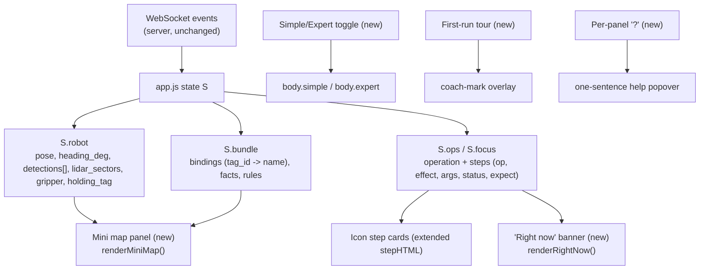
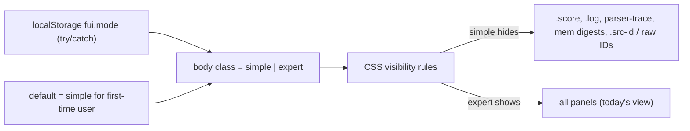

# Design Document

## Overview

`friendly-ui` makes the ENGRAM Cortex operator console more **visual**, less like an "AI dashboard," and approachable for a **first-time user** — without touching robot behavior, the safety model, or the server. It builds directly on the completed `hud-redesign` (silver/dark-grey control-room palette with a single orange accent, no-glow, reduced-motion-aware motion) and keeps that palette, every safety behavior, and **every existing element `id`** intact.

The work is a **front-end-only presentation and affordance change** confined to `web/`:

- `web/index.html` — add new panels/overlays (mini map, "Right now" banner, Simple/Expert toggle, first-run tour, per-panel "?" help) using **new** ids/classes; never remove or rename an existing id, class hook, or template.
- `web/css/hud.css` — system-sans typography, sentence-case headings, the new components, Simple-mode hiding rules, tour/help styling — all drawn from the existing palette tokens and motion band.
- `web/js/app.js` — render the mini map from existing `S.robot` state, render icon step cards, drive the "Right now" banner, wire the Simple/Expert toggle (localStorage), and run the first-run tour. All additive; existing render functions are extended, not replaced.
- `web/js/fx.js`, `web/js/voice.js` — unchanged.

### Scope

In scope: visual layer, labels/copy, progressive disclosure (Simple/Expert), onboarding (tour + per-panel help), and a top-down mini map derived from data the console already receives.

### Non-goals

- **No behavior change.** Command flow, approval/hold-to-approve, STOP/e-stop, WebSocket handlers, canvas radar/overlay, drawer, toasts, status chips, and verification all behave exactly as today.
- **No server change.** Nothing under `server/` changes; all data is consumed from the existing WebSocket `state`/`operation`/`bundle` payloads unchanged.
- **No new runtime dependency, CDN, web font, or remote image.** System fonts only. Mini map is drawn with the existing 2D canvas / inline SVG approach. (Offline constraint preserved.)
- **No new element-id removals or renames.** Existing ids are load-bearing for `app.js` and the `hud-redesign` DOM-hook property test; they are preserved.

### Approach summary

1. **Typography shift** to `-apple-system` system sans for body and headings; monospace (`ui-monospace`) reserved for IDs, digests, hashes, and numeric readouts. Headings become sentence case (CSS only; no letter-spaced caps). This is the single biggest "less AI dashboard" lever and touches CSS only.
2. **Plain-language labels and warmer copy** applied as display text, while the underlying ids/classes and data stay the same (e.g. the panel titled `PLAN` becomes "What the robot will do"; the primitive `approach_tag` renders as a **Drive** icon card).
3. **Mini map panel** — a new top-down view driven entirely from `S.robot` (`pose {x_cm,y_cm,heading_deg}`, `detections[].tag_id`, `lidar_sectors`) plus static Zone A / Zone B regions, with a dotted path for the running step. Pure presentation of existing data.
4. **Icon step cards** — `stepHTML` is extended to render each primitive as an icon card (Look / Drive / Turn / Grab / Release / Place) with a per-step progress indicator, mapping from `s.op`/`s.effect` with a safe fallback for unknown ops.
5. **"Right now" banner** — a plain-words description of the current running step (or current operation state), derived from the same op/step state that drives the plan panel.
6. **Simple/Expert toggle** — a `body`-level class that hides advanced panels in Simple mode (scoreboard, event log, parser trace, memory digests, and raw IDs), remembered in `localStorage` with `try/catch`. Expert mode shows everything (today's full view).
7. **First-run tour** — a skippable 4-step coach-mark overlay pointing at the camera, command box, approve control, and STOP, shown once (localStorage flag), fully keyboard/tap dismissible, reduced-motion aware.
8. **Per-panel "?" help** — a small info button on each panel header opening a one-sentence plain-language explanation (reuses existing tooltip/popover styling; no new dependency).

The console remains **offline-first**, **iPad landscape 1180×820 first**, honors **`prefers-reduced-motion`**, and — critically — **never shows a success state that did not come from the server** (success visuals stay bound to the server-sent `VERIFIED` operation status, exactly as today).

---

## Architecture

### Data sources (all existing)



Every new view is a **pure function of state the console already holds**. No new fetches, sockets, or fields are introduced.

### Where new UI attaches

| New element | Location in `index.html` | Drives from |
|---|---|---|
| Mini map panel | new `.panel` in `col-right` (or `col-left`), new ids `#minimap`, `#minimap-meta` | `S.robot`, Zone constants, running step |
| "Right now" banner | new `#right-now` region near top of `col-mid` plan panel | current op/step |
| Simple/Expert toggle | new `#mode-toggle` button in `.top-right` | localStorage `fui.mode` |
| First-run tour | new `#tour` overlay + `#scrim`-like dim, appended before `</body>` | localStorage `fui.toured` |
| Per-panel "?" | new `.panel-help` button inside each `.panel-h` | static copy map |

All new ids are **namespaced and additive**; no existing id is touched.

### Mode layering (Simple vs Expert)



Simple mode is implemented as **CSS that hides** advanced surfaces under `body.simple`, not by removing DOM — so `app.js` keeps rendering into those nodes and nothing breaks when the user flips to Expert. The default for a brand-new user (no stored preference) is **Simple**.

---

## Design Decisions and Rationale

### D1 — Presentation-only relabeling (ids stay, text changes)

Friendly labels are applied as **visible text**, never by renaming ids/classes. Example: the plan panel keeps `<div class="panel plan">` and `#plan-body`, but its `.panel-h span` text becomes "What the robot will do."

Label map (display text ← source):

| Source (today) | Friendly label |
|---|---|
| `PLAN` | What the robot will do |
| `MEMORY BUNDLE` | Why: rules it found |
| `ABSTAINED` | I won't do that |
| Provenance / evidence | Where this came from |
| "primitive" / `PRIMITIVE` | step |
| `OPTICAL` | Camera |
| `COMMAND` | Tell the robot |
| `SKILLS & APPROVALS` | Things it learned |
| `RUN SCOREBOARD` | Timings (Expert) |
| `EVENT LOG` | Activity (Expert) |

**Rationale:** `app.js` logic and the `hud-redesign` DOM-hook property test depend on the ids/classes. Changing only display text gives the friendly surface with zero behavioral risk.

### D2 — Icon step cards with a safe op→icon map

`stepHTML` is extended to render each step as a card with a leading **icon** and a **per-step progress** element. The op→card map is keyed on the exact allowlisted primitives in `server/plan.py` (not guessed names), with `s.effect` and then a generic "step" as fallbacks:

| Primitive `s.op` | Card | Icon | Plain verb |
|---|---|---|---|
| `observe`, `detect_tag` | Look | 👁 | "Looking" |
| `search_tag` | **Search** | 🔎 | "Searching (turning to find a tag)" |
| `drive_bounded`, `approach_tag` | Drive | ➤ | "Driving" |
| `turn_bounded` | Turn | ↻ | "Turning" |
| `pick_tagged`, `gripper_close` | Grab | ✊ | "Grabbing" |
| `gripper_open` | Release | ✋ | "Releasing" |
| `place_at` | Place | ▣ | "Placing" |
| `stop` | Stop | ■ | "Stopping" |
| unknown op | generic "step" | • | "Working" |

**`search_tag` gets its own Search card** (🔎), distinct from Look (passive detection, no motion) and Turn (a bounded rotation to a commanded angle): Search means "turn in place until a tag is seen," so its plain verb names the goal (finding a tag), matching the primitive's `label` "Turn in place until tag is seen" and its `effect: motion`.

The map falls back `op → effect → generic "step"`, so an unrecognized future primitive still renders a valid, non-throwing card (`effect: motion` → Drive-like, `effect: gripper` → Grab-like, `effect: none` → Look-like, else generic). Icons are **unicode glyphs or inline SVG** (offline; no image files). Per-step progress: `s-queued` → empty, `s-running` → an in-band indeterminate/elapsed indicator, `s-succeeded` → full, `s-failed`/`s-vetoed`/`s-stopped` → a clearly distinct "stopped" state that reads without relying on hue alone (icon/label state, not color only). Colors come from the existing palette tokens; the `li.step.e-<effect>.s-<status>` element, its `--i` stagger, and the `.st` status text are preserved so the hud-redesign step tests keep passing.

### D3 — Mini map from existing state only

A new `renderMiniMap()` draws a top-down scene into `#minimap` (canvas) using the same offline canvas approach as `drawRadar`:

- **Robot** — a triangle at `pose.x_cm,y_cm` oriented by `heading_deg`.
- **Zones A and B** — static rectangles from a `ZONES` constant (world-cm coordinates), labeled "A"/"B".
- **Tags** — a dot + tag id for each `S.robot.detections[].tag_id` (name via `nameForTag`), placed by bearing/distance or known binding.
- **Dotted path** — for the running step (`activeTag()` / current step target), a dashed line from the robot to the step's goal (e.g. the target tag or zone).
- A world→screen transform fits the scene to the panel; reduced-motion freezes any sweep/pulse, still redraws on new data.

**Rationale:** The mini map is the headline "more visual" feature, and everything it needs (`pose`, `detections`, `lidar_sectors`, bindings, running step) is already in `S`. No server change, fully offline.

### D3b — Graceful degradation of spatial panels (real robot)

The simulator sends `lidar_sectors`, `detections`, and a full `pose`. **The real robot (`HttpRobot.normalize_state`) sends `detections: []` always** (Brian's `/robot/frame` already annotates tags onto the image), **may send `pose: {}`**, and **may omit `lidar_sectors`**. The spatial panels must stay honest and calm in that case — never an empty sweep that looks broken, never an invented marker.

| Missing / empty field | Radar (`drawRadar`) | Mini map (`renderMiniMap`) |
|---|---|---|
| `lidar_sectors` absent/empty | Replace the sweep with a centered "No range data on this robot" note; still show the single `lidar_min_cm` + veto state if present | Omit the range ring; keep robot + zones |
| `detections` empty | (unchanged — overlay already draws nothing) | Omit tag dots; show a one-line "Tags are shown in the camera view" hint |
| `pose` missing / non-numeric | n/a | Show a "Position not reported" placeholder; still draw Zone A/B markers; do not place or rotate the robot |

Each guard is a simple presence/`Number.isFinite` check on the existing `S.robot` fields; both draw functions run inside the frame loop's existing `try { … } catch (e) {}`, so any slip is contained. **Nothing is simulated to fill a gap** — a degraded panel shows only what the server actually sent (Requirement 2, and the "never fabricate" honesty rule).

**Rationale:** The same console binary serves the sim (rich telemetry) and the real robot (annotated frame, sparse telemetry). The visualization must read as deliberately minimal on the real robot, not as a bug, and must never imply spatial knowledge the robot did not report.

### D4 — "Right now" plain-words banner

`renderRightNow()` produces one friendly sentence from current state:

- No op: "Ready. Tell the robot what to do."
- `PENDING_APPROVAL`: "Waiting for your OK before it moves."
- `EXECUTING` + running step: verb from D2, e.g. "Driving to the blue block." (built from step op + `nameForTag`).
- `VERIFIED`: "Done — you confirmed it worked." (**only** on server `VERIFIED`).
- `FAILED`/`HALTED`/`STOPPED`: "Stopped. Nothing else will run."
- Abstain/clarify: "I won't do that yet — here's why."

It reuses the same op/step objects `renderPlan` reads, so it is always consistent with the plan and never fabricates progress.

### D5 — Simple/Expert via body class + localStorage (safe)

```js
const MODE_KEY = "fui.mode";
function readMode() {
  try { return localStorage.getItem(MODE_KEY) || "simple"; }
  catch (e) { return "simple"; }
}
function setMode(m) {
  document.body.classList.toggle("simple", m === "simple");
  document.body.classList.toggle("expert", m === "expert");
  try { localStorage.setItem(MODE_KEY, m); } catch (e) {}
}
```

Simple mode (`body.simple`) hides, via CSS: the scoreboard panel, event-log panel, parser/trace block in memory, memory digests, and raw IDs (`.src-id`, digest/hash spans, `#plan-meta` id text). Expert shows everything. DOM is never removed, so `app.js` renders unaffected and flipping modes is instant (reduced-motion safe).

**Rationale:** First-time users are overwhelmed by scoreboards, ledgers, and hashes; hiding them by default (Simple) matches the "beginner friendly" goal while Expert preserves the full operator view. `try/catch` keeps it working in private-mode/blocked-storage iPads.

### D6 — Skippable 4-step first-run tour

A `#tour` overlay shows four coach-marks in sequence, each pointing (via a highlight ring positioned over the target element) at: **1) camera** (`.cam` / `#cam`), **2) command box** (`#cmd`), **3) approve control** (`#hold` when present, else the plan panel), **4) STOP** (`#stop`). Each card has plain copy, "Next," and an always-visible "Skip tour." Shown once:

```js
const TOUR_KEY = "fui.toured";
function maybeTour() {
  let done = false; try { done = !!localStorage.getItem(TOUR_KEY); } catch (e) {}
  if (!done && !matchMedia("(prefers-reduced-motion: reduce)").matches) startTour();
  // under reduced motion: show a single static "tips" card, still skippable
}
function endTour() { try { localStorage.setItem(TOUR_KEY, "1"); } catch (e) {} hideTour(); }
```

The tour is pure overlay: it never blocks STOP (STOP remains tappable, and reaching step 4 highlights it). Reduced-motion collapses the animated sequence into a static, dismissible tips card. Dismissal and completion both set the flag.

### D7 — Per-panel "?" help

Each `.panel-h` gains a `.panel-help` button (new class) with an `aria-label`; tapping shows a one-sentence explanation in a small popover (reusing drawer/toast-style surface tokens, no new dependency). Copy map, e.g.:

- Camera: "What the robot sees right now."
- Tell the robot: "Type or hold the mic to give a command."
- What the robot will do: "The plan. Nothing moves until you approve."
- Why: rules it found: "The rules and facts behind this plan."
- Mini map: "A top-down view of the robot, zones, and tags."

### D8 — Typography and copy (CSS-led)

- Body + headings: `font-family: -apple-system, BlinkMacSystemFont, "Segoe UI", Roboto, system-ui, sans-serif;`
- IDs/numbers/hashes/digests: keep `ui-monospace, Menlo, monospace` via a `.mono` utility and existing monospace selectors.
- Headings: sentence case, normal `letter-spacing`, remove `text-transform: uppercase` from panel headers and titles.
- Copy: shorter, warmer, second person. No glow (inherited from hud-redesign).

**Rationale:** System sans + sentence case is what makes the console read like a friendly app instead of a sci-fi AI HUD, and it is achievable almost entirely in CSS.

---

## Components and Interfaces

### New `app.js` functions (additive)

| Function | Input (existing state) | Output / effect |
|---|---|---|
| `renderMiniMap()` | `S.robot`, `ZONES`, running step | draws `#minimap` canvas |
| `renderRightNow()` | current op/step (`S.ops`, `S.focus`) | sets `#right-now` text |
| `iconForStep(s)` | `s.op`, `s.effect` | `{card, icon, verb}` (D2 map, safe fallback) |
| `readMode()` / `setMode(m)` | localStorage | toggles `body.simple`/`expert` |
| `maybeTour()` / `startTour()` / `endTour()` | localStorage, DOM targets | 4-step coach-mark overlay |
| `wirePanelHelp()` | static copy map | binds `.panel-help` popovers |

`renderMiniMap()` and `renderRightNow()` are called from the same places `renderPlan()`/`onState()` already run (on `state` and `operation` events and the frame loop as appropriate), so they stay in sync with existing renders.

### Extended `stepHTML(s)`

Returns the existing `<li class="step e-${s.effect} s-${s.status}">` structure (ids/classes preserved for the hud-redesign property tests) **plus** a leading icon element and a per-step progress bar sourced from `iconForStep(s)`. The friendly verb replaces the raw op name in Simple mode; Expert mode still shows the mono `s.op`.

---

## Data Models

No server or persisted server data model changes. New in-code structures:

### `ZONES` (JS constant, `app.js`)

| Key | Fields | Use |
|---|---|---|
| `A` | `{ x_cm, y_cm, w_cm, h_cm, label: "A" }` | mini map Zone A rectangle |
| `B` | `{ x_cm, y_cm, w_cm, h_cm, label: "B" }` | mini map Zone B rectangle |

### `localStorage` keys (client only)

| Key | Values | Default | Notes |
|---|---|---|---|
| `fui.mode` | `"simple"` \| `"expert"` | `"simple"` | read/write wrapped in `try/catch` |
| `fui.toured` | `"1"` | unset | set on tour complete or skip |

### Step icon map (JS constant)

The D2 table encoded as `OP_ICON = { scan:{…}, drive:{…}, approach_tag:{…}, turn:{…}, pick_tagged:{…}, place_at:{…}, … }` with an `EFFECT_FALLBACK` and a generic default.

---

## Correctness Properties

*Properties are universally-quantified statements the implementation must satisfy across all inputs; they bridge the spec and verification. Most of this feature is presentation and is verified by DOM/CSS inspection and visual review; the properties below target the parts where generated inputs find bugs.*

### Property 1: Element-id preservation (no regressions)

*For any* element `id` that exists in the pre-`friendly-ui` DOM (the `hud-redesign` Requirement-17 id list and `teach-tpl` inner ids), the post-`friendly-ui` DOM still contains a matching non-null element after boot.

**Validates: Requirements 6.3, 7.8, 10.4**

### Property 2: Step icon totality and determinism

*For any* step object (any `op` string including unknown/empty, any `effect`, any `status`), `iconForStep(s)` returns a defined `{card, icon, verb}` without throwing, and equal inputs always map to the same card.

**Validates: Requirements 3.1, 3.2, 3.3, 3.4**

### Property 3: Mode persistence round-trip and safe storage

*For any* mode value in `{simple, expert}`, `setMode` then `readMode` returns that value; and *for any* `localStorage` failure (throw on get or set), `readMode`/`setMode` still complete without throwing and fall back to `simple`.

**Validates: Requirements 7.2, 7.5**

### Property 4: Simple mode hides exactly the advanced surfaces

*For any* render state, when `body.simple` is set, the scoreboard, event-log, parser-trace, memory-digest, and raw-ID surfaces compute to hidden, and *for any* state under `body.expert` they are visible; the DOM nodes are never removed in either mode.

**Validates: Requirements 7.3, 7.4, 7.8**

### Property 5: No fabricated success

*For any* operation state, a success affordance (the "Done — it worked" / verified visual in the "Right now" banner, mini map, and step cards) is shown **only** when the server-sent operation status is `VERIFIED`; no client-side timer, animation, or optimistic transition produces a success state absent that server status.

**Validates: Requirements 4.3, 10.3** (never show a success the server did not send)

### Property 6: Tour is shown at most once and never blocks STOP

*For any* sequence of boots, the first-run tour auto-starts only while `fui.toured` is unset; completing or skipping it sets the flag so it does not auto-start again; and in every tour step the STOP control remains reachable (not covered by a non-interactive overlay).

**Validates: Requirements 8.1, 8.4, 8.5, 8.7**

### Property 7: Mini map is a pure function of existing state

*For any* `S.robot` snapshot (including missing `pose`, empty `detections`, absent `lidar_sectors`), `renderMiniMap()` completes without throwing and draws only from `S` + `ZONES` (it issues no network request and reads no new server field).

**Validates: Requirements 1.5, 1.6, 2.1, 2.3, 2.4**

### Property 8: Reduced-motion compliance

*For any* new animation (tour transitions, step-progress indicator, "Right now" change, mini map sweep), under `prefers-reduced-motion: reduce` the motion is disabled or reduced to a ≤100 ms residual, matching the `hud-redesign` reduced-motion contract.

**Validates: Requirements 1.8, 3.7, 8.8, 9.5**

### Property 9: Offline self-containment

*For any* new asset referenced by the friendly-ui markup/CSS/JS, the reference resolves to a local `web/` resource — no external font, image, script, or CDN URL is introduced.

**Validates: Requirements 5.4, 10.5**

### Property 10: Typography role split

*For any* ID, digest, hash, or numeric-readout element, the computed font-family is the monospace stack; *for any* body text or heading, it is the system-sans stack; and no redesign heading uses uppercase transform or letter-spaced caps.

**Validates: Requirements 5.1, 5.2, 5.3**

---

## Error Handling

- **Blocked/unavailable `localStorage`** (private mode, iPad restrictions): `readMode`/`setMode`/tour-flag access is wrapped in `try/catch`; on failure the app defaults to Simple mode and simply re-shows the tour next boot (no crash).
- **Missing robot state** (`S.robot` empty, no `pose`, empty `detections`): `renderMiniMap()` guards each field and draws whatever is present (e.g. zones only), never throwing; the frame loop's existing `try/catch` further contains any slip.
- **Unknown primitive op**: `iconForStep` falls back `op → effect → generic "step"`, so new/unrecognized primitives still render a valid card.
- **Tour target not yet in DOM** (e.g. `#hold` only exists during `PENDING_APPROVAL`): the tour points at the nearest stable container (plan panel) and never hard-requires a transient node.
- **Success gating**: all success visuals read the server `VERIFIED` status; there is no optimistic/local success path, so a dropped or delayed server confirmation can never show a false "it worked."

---

## Testing Strategy

- **DOM-hook / id-preservation check** (extends the `hud-redesign` `tests-js/dom-hooks.js`): assert every pre-existing id is still present after boot (Property 1), and that new ids exist.
- **Property-based tests (dev-only, Node + fast-check in `tests-js/`, never served):** `iconForStep` totality/determinism (P2), mode round-trip + storage-failure safety (P3), success-gating logic as a pure predicate over operation status (P5), mini map purity on arbitrary `S.robot` snapshots (P7).
- **CSS/offline static scans:** Simple-mode hide set (P4), reduced-motion residual ≤100 ms for new animations (P8), no external URLs in new markup/CSS/JS (P9), typography role split (P10). These extend the existing `scan-offline.js` approach.
- **Manual walkthrough on iPad landscape 1180×820:** first-run tour, Simple↔Expert flip, mini map tracking a running step, "Right now" wording across op states, per-panel "?" popovers, and a full approve→execute→verify run confirming success shows only after server `VERIFIED`.

---

## Requirements Mapping

Every requirement in `requirements.md` traces to one or more design decisions
(D1–D8), components, and correctness properties.

| Requirement | Design decisions / components | Properties |
|---|---|---|
| **1** Live top-down mini map | D3 `renderMiniMap()`, `ZONES` constant, running-step path; attaches as new `#minimap` panel | P7 (purity), P8 (reduced motion) |
| **2** Graceful degradation (real robot) | D3b degradation table (radar + mini map); guards on `pose`/`detections`/`lidar_sectors` | P7 (no throw on sparse state), P5 (no fabrication) |
| **3** Icon step cards | D2 op→card map incl. **Search** (`search_tag`), extended `stepHTML`, `iconForStep(s)` | P2 (totality/determinism), P8 |
| **4** "Right now" banner | D4 `renderRightNow()`, `#right-now` polite live region | P5 (no fabricated success), P8 |
| **5** System font / de-AI typography | D8 typography (system sans; mono for ids/numbers; sentence case) | P10 (typography role split), P9 (offline) |
| **6** Plain-language labels | D1 label map (presentation-only; ids/classes unchanged) | P1 (id preservation) |
| **7** Simple / Expert toggle | D5 `body.simple`/`body.expert`, `readMode`/`setMode`, pre-paint apply | P3 (round-trip + safe storage), P4 (hide set), P1 |
| **8** Skippable first-run tour | D6 `#tour` overlay, `maybeTour`/`startTour`/`endTour`, replay affordance | P6 (once + never blocks STOP), P8 |
| **9** Per-panel "?" explainer | D7 `.panel-help` in each `.panel-h`, one-sentence copy map | P1 (ids intact), P8 |
| **10** Preserved safety/honesty/compat | Cross-cutting: approval/hold + E-STOP gating unchanged (hud-redesign), id preservation, offline, iPad-first, palette | P1, P5, P9; existing hud-redesign tests (no-glow, motion band, hooks, offline) |

Cross-cutting constraints asserted by every decision: keep the hud-redesign
palette; keep all safety behavior; preserve every element id; stay offline; iPad
landscape 1180×820 first; honor reduced motion; never show a success the server
did not send.
