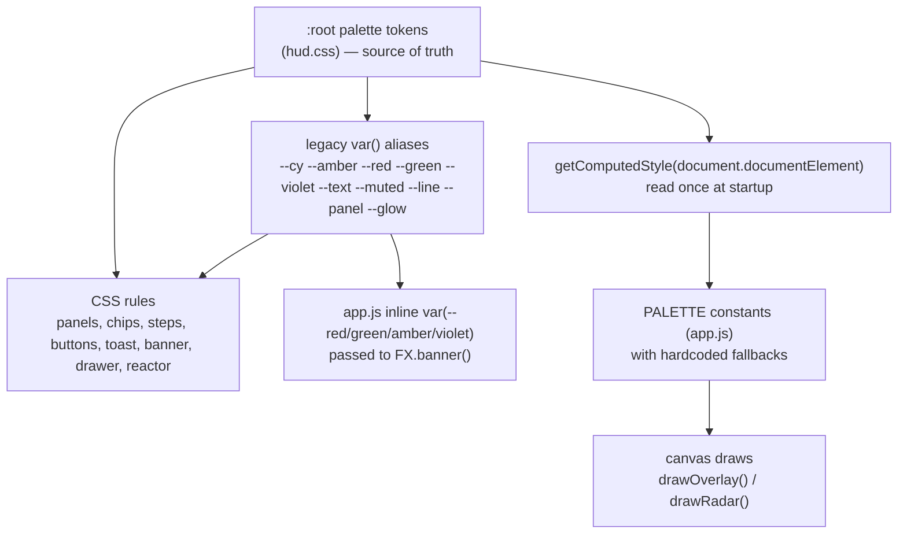
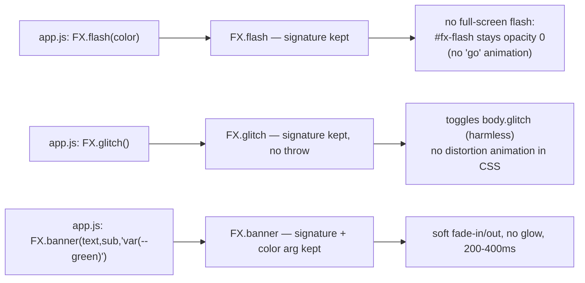

# Design Document

## Overview

This design restyles the ENGRAM Cortex iPad operator console from its current cyan/amber neon HUD to a calm silver / dark-grey "control room" aesthetic with a single comfortable orange accent, and replaces harsh motion (full-screen flashes, scanlines, screen glitch, neon glow) with smooth, reduced-motion-aware animation. It is a **styling and motion change only**.

### Scope

In scope (the only files that change, per Requirement 19.1):

- `web/index.html` — remove/neutralize effect-layer markup behavior; keep every element `id`, class hook, and template.
- `web/css/hud.css` — new palette tokens, recolored rules, retimed/retuned animations, global reduced-motion block, button hover/press states.
- `web/js/app.js` — remap hardcoded canvas color literals in `drawOverlay`/`drawRadar`, set `shadowBlur = 0`, add scoreboard count-up, honor reduced motion in the frame loop.
- `web/js/fx.js` — neutralize `FX.flash` and `FX.glitch` while keeping their signatures; soften `FX.banner`/`FX.toast`.
- `.kiro/steering/frontend-hud.md` — update palette, semantic meanings, and motion rules (Requirement 20).

### Non-goals

- **No behavior change.** Every command path, approval flow, WebSocket handler, canvas render, drawer, toast, and status chip behaves exactly as today (Requirements 17, 19).
- **No server change.** Nothing under `server/` is created, modified, or deleted; endpoints, request payloads, and WebSocket event/field shapes are consumed unchanged (Requirement 19).
- **No new runtime dependency, CDN, or web font** (Requirement 3). WebAudio sound synthesis in `fx.js` is unrelated to visuals and is left untouched.

### Approach summary

1. Establish a **single source of truth** for color in the CSS `:root` block: twelve new palette tokens. The existing variable *names* (`--cy`, `--amber`, `--red`, `--green`, `--violet`, `--text`, `--muted`, `--line`, `--panel`, `--bg`, `--glow`) are kept as **aliases** pointing at the new tokens, so the many `var(--red)`-style references in `app.js` (passed to `FX.banner`) and throughout the stylesheet keep resolving without a large rename churn.
2. Mirror the palette into a small **JS constants object** at the top of `app.js` for canvas drawing, because a 2D canvas cannot read CSS custom properties directly. The object is seeded once from `getComputedStyle(document.documentElement)` at startup with hardcoded fallbacks, so CSS stays the authority while canvas never depends on a runtime CSS read succeeding.
3. **Strip glow** everywhere: remove `--glow` box/text-shadows, set canvas `shadowBlur = 0`.
4. **Neutralize** scanlines, glitch, and full-screen flash at both the markup/CSS layer and the `FX` function layer, keeping all signatures callable.
5. **Retime motion** into a 200–400 ms ease-out band for state-change transitions, keep decorative loops gentle, and add one global `prefers-reduced-motion` block plus a JS `matchMedia` listener for runtime changes.

---

## Architecture

### File relationships and the token layer



CSS is the authority. The legacy alias names let JS keep passing `"var(--red)"` into `FX.banner` (which assigns it to `element.style.color`) and keep the e-stop vignette working. The canvas path is the one place color cannot flow through `var()`, so it reads the tokens once into a JS object (with fallbacks) — this satisfies "no color literal outside Palette_Tokens" (Requirements 9.1, 10.1) while keeping a single conceptual palette.

### Canvas color strategy — decision

**Decision: a JS `PALETTE` constants object seeded from `getComputedStyle` once at startup, with literal fallbacks.** Rationale:

- The 2D canvas API takes string colors; it cannot consume `var(--token)`. Something must hold concrete values.
- Reading `getComputedStyle(document.documentElement).getPropertyValue('--orange')` once at init keeps CSS as the single source of truth and avoids per-frame reflow cost (the frame loop runs every `requestAnimationFrame`).
- Hardcoded fallbacks in the same object guarantee correct offline rendering even if a computed read returns empty (Requirement 3.5), and they document the intended values next to the drawing code.
- The alternative — scattering literals through `drawOverlay`/`drawRadar` (today's state) — is what causes drift and is explicitly what Requirements 9.1/10.1 forbid. A single object fixes both functions from one place.

```js
// top of app.js
const CSSVAR = (n, fallback) => {
  const v = getComputedStyle(document.documentElement).getPropertyValue(n).trim();
  return v || fallback;
};
const PALETTE = {
  steel:  CSSVAR('--steel',  '#A9B4C2'),
  orange: CSSVAR('--orange', '#E8915A'),
  sage:   CSSVAR('--sage',   '#8FBF9A'),
  red:    CSSVAR('--red',    '#D96A6A'),
  muted:  CSSVAR('--muted',  '#8A9099'),
  text:   CSSVAR('--text',   '#DADDE2'),
  labelBg:'rgba(22,23,26,0.72)',   // --panel-ish, for label plates
};
// helpers for alpha tints used by the canvas
const rgba = (hex, a) => { /* hex -> rgba() */ };
```

### FX neutralization strategy



`FX.flash` and `FX.glitch` keep their exact signatures and never throw (Requirements 18.1, 18.2, 18.4), but produce no visible full-screen effect: the CSS that gave `#fx-flash.go` its flash and `body.glitch #hud` its distortion is removed, so even though the functions still toggle classes, nothing animates. `FX.banner` keeps the `color` argument (it is called as `FX.banner(text, sub, "var(--green)")`), so the legacy alias names must resolve.

---

## Design Decisions and Rationale

### D1 — Variable aliasing over rename

New semantic tokens are defined in `:root`; the existing variable names are reassigned to point at them. Example:

```css
:root {
  /* new palette (source of truth) */
  --bg: #16171A;  --panel-solid: #202226;  --raised: #2A2D32;
  --border: rgba(210,214,220,0.10);
  --text: #DADDE2;  --muted: #8A9099;
  --orange: #E8915A;  --orange-hi: #F0A574;  --orange-soft: rgba(232,145,90,0.14);
  --sage: #8FBF9A;  --red: #D96A6A;  --steel: #A9B4C2;

  /* legacy aliases so existing CSS + app.js var() keep resolving */
  --panel: var(--panel-solid);
  --line: var(--border);
  --line-hi: var(--border);
  --cy: var(--steel);        /* generic accent -> info/steel */
  --cy-dim: var(--muted);
  --amber: var(--orange);    /* attention */
  --green: var(--sage);      /* verified */
  --violet: var(--steel);    /* skill -> info/steel */
  --glow: none;              /* neutralized; any `box-shadow: var(--glow)` becomes none */
}
```

**Rationale:** `app.js` passes `var(--red)`, `var(--green)`, `var(--amber)`, `var(--violet)`, and `var(--muted)` as color strings into `FX.banner` and inline `style=` attributes, and the stylesheet references these names in dozens of places. Keeping them valid avoids touching `app.js` color strings and reduces the diff to CSS values, lowering the risk of behavioral regressions (Requirements 17, 19). `--glow: none` is a one-line kill switch for every `box-shadow: var(--glow)` / `text-shadow: var(--glow)` site (Requirement 4.2).

Because `--bg: #16171A` and `--text: #DADDE2` are set directly, the body background and default text color come from tokens (Requirement 1.6). The decorative `radial-gradient` ambient background on `body` is retuned to grey tints of `--panel`/`--raised` (no cyan/orange ambient wash).

### D2 — Cyan split by meaning

Today cyan (`--cy`) is the universal accent: panel corners, headers, step `.op b`, clock, crosshair, radar grid, robot glyph, send button, cite chips. Since the new palette assigns one meaning per accent, cyan is split:

- Cyan used as **neutral structure / default text accent** (panel corners, headers, grid lines, robot glyph, telemetry) → **silver `--text`** or **steel `--steel`** (info).
- Cyan used as a **primary action / call-to-action** (send button, `#cmd` caret/focus, engage) → **orange `--orange`**.
- Cyan used as **info status** (`ok` chip, skill/`EXECUTING`/`APPROVED` tags, cite chips) → **steel `--steel`**.

This resolves Requirement 2 (each accent token carries exactly one meaning). The mapping is captured concretely in the Color Mapping Table below.

### D3 — Global reduced-motion handling

A single `@media (prefers-reduced-motion: reduce)` block (expanded from today's one-liner) disables continuous/looping/decorative animations and caps residual transitions, plus a JS `matchMedia('(prefers-reduced-motion: reduce)')` `change` listener toggles a `body.reduced` class and a `REDUCED` flag so the canvas frame loop can render static radar/overlay snapshots at runtime without reload (Requirements 5.4, 9.6).

```css
@media (prefers-reduced-motion: reduce) {
  *, *::before, *::after {
    animation: none !important;
    transition-duration: 0.1s !important;  /* <=100ms residual (Req 5.1) */
  }
  .chip i, .reactor .r, .reactor .core, .cam-sweep,
  .skill.CANDIDATE, .step.s-running .dot, .rec i, .stop::after { animation: none !important; }
  .chip i { opacity: 1 !important; }        /* Req 8.4 */
}
```

```js
const RM = matchMedia('(prefers-reduced-motion: reduce)');
let REDUCED = RM.matches;
RM.addEventListener('change', e => { REDUCED = e.matches; document.body.classList.toggle('reduced', e.matches); });
```

The frame loop keeps calling `drawOverlay`/`drawRadar`, but under `REDUCED` the sweep angle is frozen (uses a fixed angle instead of `t`-derived), and overlay decorative rotation (`t/400`, `Math.sin(t/120)`) is held at a constant — points/brackets still redraw on new data because the loop still runs and reads current `S.robot` state (Requirements 5.2, 5.3, 9.6).

### D4 — E-stop cue redesign

Today `body.estop #fx-vignette` pulses a bright red full-screen alarm (`@keyframes alarm`, `inset 0 0 220px rgba(255,30,50,.65)`), and `onStop()` also calls `FX.glitch()` + `FX.flash("red")`. The redesign keeps a clear, calm stop cue without a full-screen flash or blink:

- `#fx-vignette` under `body.estop` shows a **steady soft-red inset border/vignette** using `--red` at low alpha — no `@keyframes alarm` blink, no full-viewport opacity change.
- `FX.flash("red")` and `FX.glitch()` still get called by `onStop` but are no-ops visually (D-FX), so the stop state reads as a steady red frame plus the existing banner/toast and STOP button, honoring Requirements 4.2, 4.5, 4.4, and 5 (a single slow pulse at most under non-reduced motion; none under reduced motion).

### D5 — "No neon glow" enforcement (audit)

Every glow source is removed or replaced:

| Source (current) | Where | Replacement |
|---|---|---|
| `--glow: 0 0 12px rgba(95,227,255,.45)` | token | `--glow: none` |
| `box-shadow: var(--glow)` | `.engage`, `#cmd:focus`, `.toast` | removed / replaced with 1px `--border` ring or `--orange` border |
| `text-shadow: var(--glow)` | `.boot-title`, `#clock` | removed |
| `text-shadow: 0 0 30px currentColor` | `.banner` | removed |
| `box-shadow: 0 0 …` glows | `.chip i`, `.mic.rec`, `.tag.skill`, `.skill.CANDIDATE` (`candGlow`), `.stop`, `.stop-clear`, `.drawer` | removed; attention conveyed by color/border/scale only |
| `@keyframes ring` `box-shadow 0 0 0 Npx` | running step | kept as an **expanding ring via border/scale**, no `box-shadow` halo (Req 11.3) |
| `filter: drop-shadow(0 0 18px …)` | `.reactor` | reduced to `drop-shadow(0 0 4px …)` max (Req 6.4) |
| `g.shadowColor/g.shadowBlur = 8` | `drawRadar` points | `shadowBlur = 0` (Req 9.2) |
| (overlay has no shadowBlur today, but add defensive `g.shadowBlur = 0`) | `drawOverlay` | `shadowBlur = 0` (Req 10.4) |

### D6 — Motion band

State-change transitions use `ease-out` (`cubic-bezier(.2,.8,.2,1)` or `ease-out`) with duration in **200–400 ms** (Requirement 4.1). Decorative loops keep gentle periods: reactor rings 4–12 s (today 7/14/20 s stay in band), reactor core pulse 1.5–4 s (today 2.2 s), status-dot breathing 3–5 s (replaces 0.6–1.2 s blink), running-step cue 0.8–2 s. The panel-entrance `pin` animation is retimed from 0.6 s to a 200–800 ms per-panel duration with a monotonic `--d` stagger (Requirement 7).

---

## Components and Interfaces

For each area: current color/effect → new palette/motion treatment. All element `id`s and class hooks are preserved (Requirement 17).

### Boot screen

- **Reactor** (`.reactor .r/.core/.spokes`): cyan strokes + `drop-shadow(0 0 18px cyan)` → strokes/fills use **orange + silver** tokens only (Req 6.1); `drop-shadow` capped at 4px (Req 6.4). Keep `@keyframes spin` (rings, 7/14/20 s — in the 4–12 s band for the two faster rings; the 20 s ring is slowed/kept but is decorative and disabled under reduced motion) and `@keyframes pulse` (core, 2.2 s) recolored to orange/silver (Reqs 6.2, 6.3). Under reduced motion, rings/core hold position (Req 6.5).
- **Title** `.boot-title` + `span`: cyan + `text-shadow: var(--glow)` → silver text, orange `span`, no text-shadow.
- **Boot log** `#boot-log` (`b`=green, `i`=amber): → `b`=sage, `i`=orange, body muted.
- **Engage** `.engage`: cyan glow + `@keyframes breathe` (box-shadow glow) → orange border + `--orange-soft` fill; `breathe` changed to a non-glow gentle opacity/scale breath (or removed in favor of a static orange button with hover/press), reduced-motion static.

### Top bar

- **Mini-reactor** `.mini-reactor`: cyan → steel/orange, same spin/pulse keyframes recolored.
- **Brand** `.brand span`: cyan → orange accent.
- **Status dots** `.chip i` + `.chip.ok/warn/bad`: today `box-shadow: 0 0 6px currentColor` glow and `@keyframes blink` (0.6–1.2 s harsh). → **breathing** via new `@keyframes breathe-dot` (opacity 0.4↔1.0, 3–5 s, continuous, ≤0.1 opacity per 100 ms — Reqs 8.1, 8.2); colors `ok`→steel, `warn`→orange, `bad`→red (Req 8.3); no glow; reduced-motion fixes opacity 1.0 (Req 8.4).
- **Clock** `#clock`: cyan + glow → silver/steel, no text-shadow.
- **Icon buttons** `.icon-btn`: cyan tint → steel/`--orange-soft` hover per D7 button spec.

### Camera panel

- **Corners** `.cam-corners i` (cyan): → steel at low opacity.
- **Sweep** `.cam-sweep` (cyan gradient): → faint steel gradient, keep `@keyframes sweep` (4 s) subtle; reduced-motion off.
- **Heading tape** `#tape` (cyan) + `.caret` (amber): → silver tape, orange caret.
- **Cam message** `.cam-msg` (cyan-dim): → muted.
- **Overlay canvas** `#cam-overlay` (`drawOverlay`): see Color Mapping Table + Req 10. Crosshair/ticks/labels/telemetry → steel; locked bracket + ring + "TARGET LOCK" → orange; `shadowBlur = 0`; geometry/label text/pulse/rotation preserved (Req 10.5).

### Command panel

- **Input** `#cmd`: cyan caret + `box-shadow: var(--glow)` focus → orange caret, focus ring = 1px `--orange` border (no glow).
- **Mic** `.mic`/`.mic.rec`: cyan fill, red glow → steel idle fill; recording state uses `--red` border/tint, no glow; keep the `#wave` canvas behavior.
- **Send** `.send`: cyan gradient border → **orange** primary button (D7), `--orange-soft`→`--orange` gradient, hover/press states.
- **Heard** `#heard` (amber) + typing caret (blink): → orange text; caret uses gentle breathe not harsh blink.
- **Quick buttons** `.quick button`, `.danger`, `.amb`: dashed cyan → dashed `--border`; `.danger`→soft-red border/text, `.amb`→orange; hover/press per D7.

### Plan panel

- **Op header** `.op-goal`/`.op-sub`: silver/muted (no cyan).
- **Tags** `.tag.skill` (violet glow), `.tag.grammar` (cyan), `.tag.llm` (amber), `.tag.status-*`: skill→steel (no glow), grammar→steel, llm→orange; status `PENDING_APPROVAL`/`NEEDS_VERIFICATION`→orange, `EXECUTING`/`APPROVED`→steel, `VERIFIED`→sage, `FAILED`/`HALTED`/`STOPPED`/`REJECTED`/`EXPIRED`/`CANCELLED`→red (Req 11.4, 11.5, and Req 2). The `PENDING_APPROVAL` blink becomes a gentle breathe.
- **Steps / progress line** `.steps::before` connector + `.step .dot`: cyan → steel connector and dots (Req 11.1). Entrance `@keyframes sin` kept, retimed to 200–400 ms preserving `--i` stagger (Req 11.2). Running cue `.step.s-running .dot` `@keyframes ring`: recolored orange, **no `box-shadow` halo** — reimplemented as an expanding `border`/`transform: scale` ring, single cycle 0.8–2 s (Req 11.3). Status colors: running→orange, succeeded→sage, skipped→steel, unknown→steel, failed/vetoed/stopped/rejected→red (Reqs 11.4, 11.5). Reduced-motion: final state, no entrance/running cue (Req 11.6).
- **Perm box** `.perm` (amber dashed): → orange dashed + `--orange-soft`.
- **Hold-to-approve** `.hold` + `.fill` (green today): → **orange** (Reqs 12.1, 12.5). Behavior preserved: `app.js` drives `fill.style.width` from 0→100% over 800 ms via `requestAnimationFrame`; release before commit resets to 0 (Reqs 12.2, 12.3). `.fill` gradient uses `--orange-soft`→`--orange`, no glow (Req 12.4).
- **Reject** `.reject`: red → soft-red; distinct token from hold (orange) per Req 12.5.
- **TTL ring** `.ttl .fg/text` (amber): → orange; keep `stroke-dashoffset` transition.
- **Verify row** `.v-ok` (green)/`.v-no` (red): → sage / soft-red.
- **Outcome** `.outcome.good/warn/bad`: → sage / orange / soft-red.
- **Abstain/clarify** `.abst`/`.abst.clar`: red / amber → soft-red / orange.
- **History** `.history`: muted/steel, no change in structure.

### Memory panel

- **Facts** `.fact` (cyan border), `.fact.rule` (amber): → steel left-border; rule→orange. Keep `@keyframes sin` entrance (retimed if outside band).
- **Cites** `.cite` (cyan + `§` amber): → steel chip, orange `§`.
- **Binds/sec-h/trace/missing**: cyan-dim/amber → steel/muted; `.missing`→orange.

### Radar panel

- **Canvas** `#radar` (`drawRadar`): grid/labels/glyph → steel; veto zone → soft-red tint; points by distance → red (<20) / orange (20–40) / sage (≥40); sweep gradient → steel; `shadowBlur = 0`. Geometry (`toXY`, sweep angle, radius scale) unchanged (Reqs 9.1–9.5). Reduced-motion: static sweep, redraw on new data (Req 9.6).
- **Veto badge** `.veto-badge` (red bg + blink): → steady soft-red badge, blink → gentle breathe or static (no harsh blink).
- **Sim control** `.sim-ctl` (amber): → orange/steel, buttons per D7.

### Skills panel

- **Skill cards** `.skill` + states: `CANDIDATE` violet glow + `@keyframes candGlow` → steel border with a **non-glow** attention cue (subtle `--orange-soft` border breathe or static highlight), `APPROVED`→sage, `REJECTED`/`REVOKED`→red. `.sk-view` cyan → steel.

### Scoreboard

- **Grid** `.sc-grid .hd` (cyan), `.bar i` (cyan), `.delta` (green): → steel headers, steel/orange bar, sage delta. `.bar i` keeps its width transition (retimed to band).
- **Count-up**: new `app.js` behavior in `renderScore` (see Interactions D-Score). Comparison logic and rows unchanged (Req 15.5).

### Log panel

- `.log-body li` colors: `.t`→muted/steel, `.warn`→orange, `.err`→soft-red, `.good`→sage. Keep `@keyframes logIn` (0.3 s, in band; recolor its brief background tint from cyan to `--raised`).

### STOP button + clear

- `.stop`: deep red gradient + heavy glow + `@keyframes sonar` → keep the red stop identity but **remove glow box-shadows**; `sonar` ring kept as a single calm pulse (decorative, disabled under reduced motion). `:active` scale preserved.
- `.stop-clear` (amber + glow): → orange, no glow, hover/press per D7.

### Drawer, scrim, teach form

- `.drawer`: dark cyan-bordered panel + heavy shadow → `--panel`/`--raised` surfaces, `--border` left edge; keep `transform .35s` → retimed/eased to 200–400 ms ease-out (Reqs 16.1, 16.2, 16.5).
- `.scrim`: keep `opacity .3s` → matched to the drawer duration (Req 16.3); reduced-motion instant (Req 16.4).
- `.drawer-body` accents (`.src-id` amber, `blockquote` amber, `.imm` green): → orange / orange / sage.
- `.teach` inputs: cyan borders → `--border`; focus → orange ring.

### Toast and banner (`fx.js` + CSS)

- `.toast` (cyan border + glow; `.red/.amber/.green`): → `--panel` surface, `--border`, no glow; variants sage/orange/soft-red (Req 13.3). Slide/opacity transition retimed to 200–400 ms ease-out (Req 13.2); reduced-motion opacity-only (Req 13.6). `FX.toast(text, kind)` signature unchanged (Req 13.4); unknown `kind` → default variant, no throw (Req 13.5).
- `.banner` (cyan + `text-shadow` glow + `@keyframes banner` scale/letter-spacing): → soft fade, no glow, 200–400 ms (Reqs 13.1, 13.2). `FX.banner(text, sub, color)` signature + `color` arg preserved; variant colors sage/orange/soft-red (Req 13.3).

### Effect layers (markup/CSS)

- `#fx-scan`: scanline `repeating-linear-gradient` removed → element kept but transparent (no pixels changed) (Reqs 4.3, 18.7).
- `#fx-flash`: `.go` flash animation removed → stays `opacity: 0`, no full-screen flash (Reqs 4.5, 18.3).
- `body.glitch #hud`: `@keyframes glitch` removed → `FX.glitch` toggles a harmless class, no distortion (Reqs 4.4, 18.4, 18.5).
- `#fx-vignette`: keep; `body.estop` steady soft-red inset (no `@keyframes alarm` blink) (D4).

---

## Data Models

This feature introduces no server or persisted data model. It defines two in-code structures:

### `PALETTE` (JS, `app.js`)

| Key | CSS token | Fallback | Used by |
|---|---|---|---|
| `steel` | `--steel` | `#A9B4C2` | overlay crosshair/ticks/labels/telemetry, radar grid/labels/glyph |
| `orange` | `--orange` | `#E8915A` | overlay locked bracket/ring/lock text, radar warn point (20–40 cm) |
| `sage` | `--sage` | `#8FBF9A` | radar normal point (≥40 cm) |
| `red` | `--red` | `#D96A6A` | radar close point (<20 cm), radar veto zone tint |
| `muted` | `--muted` | `#8A9099` | overlay sub-labels, radar distance labels |
| `text` | `--text` | `#DADDE2` | overlay primary label text |
| `labelBg` | — | `rgba(22,23,26,0.72)` | overlay label plate background |

### Palette tokens (CSS `:root`)

| Token | Value | Semantic role |
|---|---|---|
| `--bg` | `#16171A` | document background |
| `--panel-solid` (`--panel`) | `#202226` | panel surface |
| `--raised` | `#2A2D32` | raised surface |
| `--border` (`--line`, `--line-hi`) | `rgba(210,214,220,0.10)` | borders/dividers |
| `--text` | `#DADDE2` | silver primary text |
| `--muted` | `#8A9099` | muted/secondary text, disabled |
| `--orange` | `#E8915A` | **primary / attention** |
| `--orange-hi` | `#F0A574` | orange hover |
| `--orange-soft` | `rgba(232,145,90,0.14)` | orange fill/tint |
| `--sage` | `#8FBF9A` | **verified** |
| `--red` | `#D96A6A` | **stop / veto / abstain** |
| `--steel` | `#A9B4C2` | **info / skill** |

---

## Correctness Properties

*A property is a characteristic or behavior that should hold true across all valid executions of a system — essentially, a formal statement about what the system should do. Properties serve as the bridge between human-readable specifications and machine-verifiable correctness guarantees.*

This is primarily a styling/motion redesign, so most acceptance criteria are verified by static inspection, example-based DOM/CSSOM checks, visual review, and offline integration checks (see Testing Strategy). The properties below cover the subset of criteria that are genuine universally-quantified statements over an input domain — pure color-selection and coordinate functions, timing/interpolation math, structural invariants over the stylesheet, and total (never-throwing) effect functions. These are the parts where generated inputs find bugs that a few examples would miss.

### Property 1: CSS custom-property referential integrity

*For any* `var(--token)` reference appearing anywhere in `hud.css`, the referenced `--token` is defined in the `:root` block (treating the stylesheet as a closed world).

**Validates: Requirements 1.7**

### Property 2: Semantic token bijection

*For any* assignment of the four accent roles (primary/attention, verified, stop/abstain, info/skill) to palette tokens, the role→token map over {`--orange`, `--sage`, `--red`, `--steel`} is a bijection, and any two selectors sharing a semantic role resolve to the identical token value.

**Validates: Requirements 2.5, 2.6**

### Property 3: Transition timing band

*For any* state-change transition declaration introduced by the redesign, the resolved duration lies within 200–400 ms inclusive and the timing function is an ease-out curve.

**Validates: Requirements 4.1**

### Property 4: No-glow invariant

*For any* styled surface and *for any* canvas draw call, no luminous-halo shadow is applied: no `box-shadow`/`text-shadow` is used to produce a glow, and every canvas draw executes with `shadowBlur` equal to 0.

**Validates: Requirements 4.2, 9.2, 10.4**

### Property 5: Panel-entrance delay monotonicity

*For any* two `.panel-in` elements with distinct `--d` values, the computed entrance start delay is strictly increasing in `--d`, so no two consecutive panels in `--d` order start at the same instant.

**Validates: Requirements 7.2**

### Property 6: Canvas colors sourced from the palette

*For any* color assignment made inside `drawOverlay` or `drawRadar`, the color value is drawn from the `PALETTE` constants (or an alpha-tint derived from a `PALETTE` entry), never a legacy neon literal.

**Validates: Requirements 9.1, 10.1**

### Property 7: Radar point color by distance threshold

*For any* obstacle distance `cm ≥ 0`, the plotted point color equals the soft-red token when `cm < 20`, the orange token when `20 ≤ cm < 40`, and the sage token when `cm ≥ 40`.

**Validates: Requirements 9.3, 9.4**

### Property 8: Radar geometry invariance

*For any* bearing degree, distance, and time `t`, the restyled radar's coordinate mapping (`toXY`, sweep angle, and distance-to-radius scale) produces coordinates pixel-identical to the pre-restyle reference implementation for the same inputs.

**Validates: Requirements 9.5**

### Property 9: Overlay bracket color by lock state and content invariance

*For any* detection, the target bracket and ring color equal the orange token when the detection matches the active locked target and the default steel token otherwise; and *for any* set of detections and time, the overlay's bracket corner geometry, label and sub-label text, "TARGET LOCK" text, and telemetry readout content are identical to the pre-restyle reference, differing only in color.

**Validates: Requirements 10.2, 10.3, 10.5**

### Property 10: Hold-to-approve fill progress

*For any* elapsed hold time `t` milliseconds in `[0, 800]`, the fill progress equals `min(t / 800, 1) × 100` percent; and *for any* release occurring before 800 ms of continuous hold, authorization is withheld and the fill resets to 0 percent.

**Validates: Requirements 12.2, 12.3**

### Property 11: Scoreboard count-up interpolation

*For any* numeric start value, numeric end value, and duration within 200–400 ms, the count-up value is monotonic from start toward end, never overshoots end, and equals exactly end at completion; *for any* missing or non-numeric metric value, no count-up runs and the placeholder is shown; and *for any* new end value arriving mid-animation, the in-progress animation is cancelled and a new count-up starts toward the new end.

**Validates: Requirements 15.1, 15.2, 15.3, 15.6, 15.7**

### Property 12: FX graceful default for unknown variants

*For any* variant/kind argument (including unknown strings, empty, or undefined), `FX.toast` and `FX.banner` display the message using a default variant without raising an error.

**Validates: Requirements 13.5**

### Property 13: FX effect functions are total

*For any* argument value passed to `FX.flash` (including a color, undefined, or an arbitrary value) and *for any* call to `FX.glitch`, the function completes without throwing.

**Validates: Requirements 18.2, 18.4**

### Property 14: DOM hook presence

*For any* `id` in the Requirement 17.1 list and *for any* class selector in the Requirement 17.3 list, the post-boot DOM contains a matching non-null element or node, the `teach-tpl` template exposes its four inner ids after cloning, and toggling `body.estop` or `body.glitch` raises no exception.

**Validates: Requirements 17.1, 17.2, 17.3, 17.4, 17.5**

---

## Error Handling

- **Missing computed CSS token at canvas init:** `CSSVAR(name, fallback)` returns the hardcoded fallback when `getComputedStyle` yields an empty string, so canvas rendering is correct even if the stylesheet load order or an offline edge case leaves a token unread (Requirement 3.5, Property 6 fallbacks).
- **Unknown toast/banner variant:** `FX.toast`/`FX.banner` map any value outside {success, attention, stop} to a default (base) variant class and still render, never throwing (Requirement 13.5, Property 12).
- **Neutralized effects still invoked:** `FX.flash(anything)` and `FX.glitch()` keep their class-toggle bodies guarded so they never throw even though the CSS no longer animates (Requirements 18.2, 18.4, Property 13). `drawOverlay`/`drawRadar` already run inside the `try { … } catch (e) {}` of `frameLoop`, so a transient null from `S.robot` cannot break the loop.
- **Non-numeric scoreboard value:** the count-up is gated on `Number.isFinite`; non-numeric or missing values skip animation and render the existing placeholder (Requirement 15.6).
- **Reduced-motion toggle at runtime:** the `matchMedia` `change` listener updates state within one event tick (well under the 1 s budget) with no reload (Requirement 5.4).

---

## Testing Strategy

This is a front-end change. The repository's existing `tests/` directory holds Python API/PBT tests for the server and is **not** extended here (touching it would risk the Requirement 19 scope boundary). Verification is lightweight and front-end appropriate: static scans, a small DOM/offline check, manual flow walkthroughs, and a focused set of property tests for the pure-logic pieces.

### Dual approach

- **Property tests** cover the pure functions and structural invariants in the Correctness Properties section: color-by-distance (P7), radar geometry invariance vs. a reference (P8), overlay lock-color + content invariance (P9), hold-fill math (P10), count-up interpolation (P11), FX totality/graceful default (P12, P13), CSS referential integrity and semantic bijection (P1, P2), transition-band and no-glow scans (P3, P4), panel-delay monotonicity (P5), canvas-color sourcing (P6), and hook presence (P14).
- **Example / integration / visual checks** cover the rendering, layout, reduced-motion, and offline criteria that are not input-varying.

### Property-based testing

PBT is appropriate here only for the extracted pure logic. To make these testable without inventing a heavy harness, the pure functions are factored out of the canvas/DOM code so they can be imported in isolation:

- `pointColor(cm) -> token` (radar) — P7
- `toXY(deg, cm, cx, cy, R, maxCm)`, `sweepAngle(t)`, `radiusFor(cm, R, maxCm)` (radar geometry) — P8, with a frozen reference copy of the original math checked in as the model
- `bracketColor(locked) -> token` and the label/telemetry string builders (overlay) — P9
- `fillPercent(elapsedMs) -> number` (hold) — P10
- `countupValue(start, end, tElapsed, duration) -> number` and `isAnimatableMetric(v) -> bool` (scoreboard) — P11

Use **fast-check** (the standard JS property library; vendored locally or run under Node in dev — it is a dev/test-only dependency and is never loaded by the offline console, so Requirement 3 is unaffected). Each property test runs **≥ 100 iterations** and is tagged:

```
// Feature: hud-redesign, Property 7: radar point color by distance threshold
```

CSS-structure properties (P1, P2, P3, P4, P5) are checked by parsing `hud.css` text (token definitions, `var()` references, transition/animation declarations, shadow declarations) — also expressible as fast-check properties over the enumerated declaration/reference sets.

### Example, integration, and visual verification

- **Offline / no external resources (Req 3, 19.3, 19.4):** grep `web/**` for `http://`, `https://`, protocol-relative `//`, and known CDN/font-service hosts in style/script/layout assets — assert none. Manual: load the page with networking disabled (DevTools offline), confirm full render within 3 s and zero external requests in the Network panel.
- **Hook presence (Req 17, Property 14):** a small throwaway DOM check (run in the browser console or a jsdom snippet) that iterates the full `id` list from Req 17.1 and the selector list from Req 17.3 after boot, asserting every `getElementById`/`querySelector` is non-null and the `teach-tpl` clone exposes `t-text`/`t-tag`/`t-zone`/`t-trig`.
- **Reduced motion (Req 5, 6.5, 8.4, 9.6, 11.6, 13.6, 16.4):** with DevTools "emulate prefers-reduced-motion", confirm no continuous animations, status dots fixed at opacity 1.0, radar not sweeping (but updating on new sim obstacles), drawer/toast instant. Toggle the setting live and confirm the HUD responds without reload.
- **No-glow audit (Req 4.2, Property 4):** visual pass plus grep for residual `0 0 Npx` glow shadows, `text-shadow`, `drop-shadow(0 0 …)` > 4px, and `shadowBlur` > 0.
- **Behavior unchanged (Req 17, 19):** manual walkthrough of the core flows — boot → ENGAGE; type/quick-command → plan renders; hold-to-approve 800 ms → authorizes; release early → cancels; reject; verify ok/no; STOP → e-stop state + CLEAR; evidence cite → drawer; teach rule — confirming each path works identically and no uncaught console errors appear (especially on `FX.flash`/`FX.glitch`/`body.estop`/`body.glitch`).
- **Steering file (Req 20):** confirm front matter unchanged, all ten palette entries present, four semantic mappings, motion rules, and the four preserved legacy rules.
- **Server-untouched (Req 19):** confirm the change set touches only `web/**` and `.kiro/steering/frontend-hud.md` (e.g., `git diff --name-only`), and that `app.js` still calls the same endpoints/methods/payloads.

---

## Color Mapping Table

### CSS variables and literals (`hud.css`)

| Old token / literal | Meaning in old design | New token | New value |
|---|---|---|---|
| `--bg #03070c`, `--bg2 #07111a` | background | `--bg` | `#16171A` |
| `--panel rgba(8,22,32,.72)` | panel surface | `--panel` → `--panel-solid` | `#202226` |
| (new) | raised surface | `--raised` | `#2A2D32` |
| `--line`, `--line-hi` (cyan borders) | borders | `--line`/`--line-hi` → `--border` | `rgba(210,214,220,0.10)` |
| `--cy #5fe3ff` (generic/info/action) | accent | `--cy` → `--steel`; actions → `--orange` | `#A9B4C2` / `#E8915A` |
| `--cy-dim #2a8fa8` | dim accent | `--cy-dim` → `--muted` | `#8A9099` |
| `--amber #ffb547` | attention | `--amber` → `--orange` | `#E8915A` |
| `--red #ff3b4e` | stop/veto/abstain | `--red` | `#D96A6A` |
| `--green #3dffa8` | verified | `--green` → `--sage` | `#8FBF9A` |
| `--violet #b48cff` | skill | `--violet` → `--steel` | `#A9B4C2` |
| `--text #d8f6ff` | body text | `--text` | `#DADDE2` |
| `--muted #6f97a6` | muted text | `--muted` | `#8A9099` |
| `--glow 0 0 12px …` | neon glow | `--glow` | `none` |

### Canvas literals (`app.js`)

| Function | Old literal | Role | New source |
|---|---|---|---|
| `drawOverlay` | `rgba(95,227,255,.55/.5/.75)` | crosshair / ticks / telemetry | `PALETTE.steel` (alpha tint) |
| `drawOverlay` | `"95,227,255"` | non-locked bracket | `PALETTE.steel` |
| `drawOverlay` | `"255,181,71"` / `rgba(255,181,71,1)` | locked bracket / ring / "TARGET LOCK" | `PALETTE.orange` |
| `drawOverlay` | `rgba(0,0,0,.6)` | label plate | `PALETTE.labelBg` |
| `drawOverlay` | `rgba(216,246,255,.8)` | sub-label | `PALETTE.muted` |
| `drawRadar` | `rgba(95,227,255,.18)` | grid rings/spokes | `PALETTE.steel` (alpha) |
| `drawRadar` | `rgba(111,151,166,.8)` | distance labels | `PALETTE.muted` |
| `drawRadar` | `rgba(255,59,78,.14)` | veto zone | `PALETTE.red` (alpha) |
| `drawRadar` | cyan sweep gradient | sweep | `PALETTE.steel` (alpha gradient) |
| `drawRadar` | `#ff3b4e` (close) | point < 20 cm | `PALETTE.red` |
| `drawRadar` | `#ffb547` (warn) | point 20–40 cm | `PALETTE.orange` |
| `drawRadar` | `rgba(61,255,168,.9)` (normal) | point ≥ 40 cm | `PALETTE.sage` |
| `drawRadar` | `#5fe3ff` | robot glyph | `PALETTE.steel` |
| `drawRadar` | `g.shadowBlur = 8` | point glow | `g.shadowBlur = 0` |

---

## New Interactions Design

### D7 — Button hover and press states (Req 14)

A shared rule set applies to every interactive button (`.icon-btn`, `.send`, `.mic`, `.quick button`, `.hold`, `.reject`, `.verify-row button`, `.sk-btns button`, `.sk-view`, `.sim-ctl button`, `.drawer-h button`, `#stop-clear`, `#engage`). Because the iPad is touch-primary, `:active` (press) is the primary feedback and `:hover` is guarded so it does not "stick" on touch:

```css
button { transition: background .25s ease-out, border-color .25s ease-out, transform .25s ease-out, opacity .25s ease-out; }
@media (hover: hover) {
  button:not(:disabled):hover { border-color: var(--orange-hi); background: var(--orange-soft); }
}
button:not(:disabled):active { transform: scale(.97); background: var(--raised); }
button:disabled { color: var(--muted); border-color: var(--border); background: transparent; opacity: .5; }
button:disabled:hover, button:disabled:active { transform: none; background: transparent; }
```

All transitions are in the 200–400 ms band (Reqs 14.1–14.3), no glow (Req 14.5), disabled buttons are muted and suppress hover/press (Req 14.6). Primary/attention controls additionally carry the orange identity (send, hold, engage); the reject/STOP controls carry the red identity.

### D-Score — Scoreboard count-up (Req 15)

`renderScore` keeps its run-comparison logic and row set unchanged (Req 15.5). After it writes the grid markup, a post-pass animates each numeric `.v` cell from its previously displayed numeric value (or 0) to the new server value using `requestAnimationFrame` over a duration in the 200–400 ms band with ease-out. Each cell tracks its own animation handle so a new value mid-flight cancels and restarts (Req 15.7).

```js
function countUp(el, to, dur = 320) {
  if (REDUCED || !Number.isFinite(to)) { el.textContent = Number.isFinite(to) ? to : el.textContent; return; }
  cancelAnimationFrame(el._cu);
  const from = Number.isFinite(parseFloat(el.dataset.val)) ? parseFloat(el.dataset.val) : 0;
  const t0 = performance.now();
  const ease = p => 1 - Math.pow(1 - p, 3); // ease-out cubic
  const step = now => {
    const p = Math.min((now - t0) / dur, 1);
    const v = from + (to - from) * ease(p);
    el.textContent = Math.round(v);
    if (p < 1) el._cu = requestAnimationFrame(step);
    else { el.textContent = to; el.dataset.val = to; } // land exactly on server value (Req 15.3)
  };
  el._cu = requestAnimationFrame(step);
}
```

Non-numeric cells (`planner`, `verified by`, `—` placeholders) skip the count-up and render as today (Req 15.6). Under reduced motion, values appear immediately (Req 15.4). The final displayed value always equals the server-reported value and no unreported value is fabricated (Req 15.3).

### D-Drawer — Evidence drawer expand (Req 16)

The drawer already transitions `transform` (`.35s`); the redesign normalizes it to an ease-out curve in the 200–400 ms band and ties the `#scrim` `opacity` transition to the **same duration** so they move together (Reqs 16.1–16.3). Surfaces use `--panel`/`--raised` (Req 16.5). Under reduced motion both appear/disappear instantly (Req 16.4):

```css
.drawer { transition: transform .3s ease-out; }
.scrim  { transition: opacity .3s ease-out; }
@media (prefers-reduced-motion: reduce) {
  .drawer, .scrim { transition: none !important; }
}
```

---

## Steering File Update Plan (Req 20)

`.kiro/steering/frontend-hud.md` is updated **in place**, keeping its `inclusion: fileMatch` and `fileMatchPattern: "web/**"` front matter unchanged (Req 20.1).

**Changed sections:**

- **Palette block (new):** a named list of all ten entries — background `#16171A`, panel `#202226`, raised `#2A2D32`, border `rgba(210,214,220,0.10)`, silver text `#DADDE2`, muted text `#8A9099`, orange `#E8915A`, sage `#8FBF9A`, soft red `#D96A6A`, steel `#A9B4C2` (Reqs 20.2, 20.3).
- **Semantic meanings (replaced):** the old "Cyan = system, amber = attention, green = verified, red = stop, violet = skill" line is replaced with the four-role mapping — primary/attention → orange, verified → sage, stop/abstain → soft red, info/skill → steel (Req 20.4).
- **Motion rules (new):** 200–400 ms ease-out transition band; explicit prohibition of neon glow, scanlines, glitch, and full-screen flash; and an explicit statement that `prefers-reduced-motion` must be honored (Req 20.5).

**Preserved verbatim in meaning (Reqs 20.6, 20.7):**

- No movie/comic franchise names, logos, or character names in the UI.
- Approvals use a deliberate 0.8 s hold, never a single tap.
- Every status shown must come from the server; never animate a fake success.
- Layout targets: iPad landscape 1180×820 and portrait; phone width stacks columns.
